# github-recommender — Architecture & Data Flow

A tutorial for anyone (including future-you) picking this repo up cold.

---

## 1. What this project is

This is a **hybrid recommender system for GitHub repository topics**. Given a repository's README
text, it predicts which topic labels (`python`, `machine-learning`, `rest-api`, …) that repository
should carry.

"Hybrid" is the key word, and it's the thing the README never says: the system is **two recommenders
chained together**, not two competing baselines.

```
README text ──► CNBN (content-based) ──► top-5 topics ──► TopFilter (collaborative) ──► Topics Merger ──► final ranking
                                                                 │                            │
                                                                 │                            └── knowledge graph (sedkgraph.csv)
                                                                 └── 20 nearest-neighbour repos
```

- **CNBN** = **C**omplement **N**aive **B**ayes + k**N**owledge graph. It reads README text, fits a
  `ComplementNB` classifier over TF-IDF features, and predicts topics. It is *content-based*: it only
  looks at the repository's own text.
- **TopFilter** is a *collaborative filter*. It ignores text entirely and instead asks "which other
  repositories have a similar topic set?", then recommends topics those neighbours have.

The bridge between them is a single file: `training_data.csv`. CNBN writes its predictions there —
to `results/` for reporting and to `outpath/TopFilter/`, where TopFilter reads them back as seed
input (it calls them "EASE output"). This is what makes the system hybrid: the collaborative stage
starts from the content stage's guesses rather than from nothing.

**Which topics TopFilter actually reads depends on which side of the split a repository is on.**
For the ~579 **training** repositories of a fold it always reads the **owner-defined** topics, out of
the `dicth_` / `graph_` files Stage D exported (`topic_similarity_calculator.py:62`,
`recommendation_engine.py:71-75`). For the ~65 **test** repositories the owner's topics are the thing
being predicted, so they are held out as ground truth and something else stands in as the visible
profile:

- *Bayesian mode* — `extract_EASE_dictionary` (`data_reader.py:154`) builds the test repo's
  dictionary as `{1: reponame}` plus CNBN's top 5, and opens `dicth_` **only** to copy every real
  topic into `GroundTruth/`. None of them are returned, so the repo's own topics never enter the
  similarity vector or row 20 of the user-item matrix.
- *Half mode* — `extract_half_dictionary` (`data_reader.py:84`) returns the first half of the real
  topics and holds back the second half. Here a test repo's owner-defined topics *are* read.

`runner.main()` hardcodes `runner.run(True)`, so bayesian is the only path a default run executes,
and in it a test repository's visible profile is entirely CNBN output.

The usual motivation for this design — cold start, repositories with few or no topics — is inherited
from the source papers rather than exercised here: Stage C keeps only repositories with **more than
4** topics, so the seeding simulates the cold-start case instead of encountering it.

A second coupling matters almost as much: both stages take their train/test split from **one shared
fold assignment**, `custom_dataset/folds.json`, written by `scripts/make_folds.py`. Before that file
existed the two branches split independently and the hybrid was mostly measuring fold mismatch
(§4, item 11).

The knowledge graph enters in two optional places, both behind environment flags: as a topic
canonicaliser in Stage C (`KG_NORMALISE=1`), and inside TopFilter's **Topics Merger** in Stage F
(`KG_ENABLED=1`), which is where expansion actually belongs — it is the only point that sees both
branches' outputs at once.

Here is the whole system at a glance (⊗ marks a divergence documented in §4):

```mermaid
flowchart LR
    subgraph A["A · Ingestion — Go"]
        KAGGLE[/"Kaggle dump<br/>repos ≥5 stars"/]
        JSON["pretty-dataset.json<br/>3.7 GB"]
        ALLOW["all_topics.csv<br/>863 topics"]
        EXPORT["cmd/export_repos"]
        CONVERT["cmd/convert_dataset"]
        LIST["repos_list.txt"]
        REPOCSV["repositories.csv"]
    end

    subgraph B["B · Mining"]
        MINER["miner.py"]
        READMES["repo_readme/"]
        MINEDCSV["repositories_test.csv<br/>mined subset"]
    end

    subgraph C["C · Normalization"]
        RULES["rules/*.csv"]
        PREP["preprocess()<br/>13 rewriting passes"]
        KGNORM["kg_normalise.py<br/>optional · KG_NORMALISE"]
    end

    subgraph D["D · Export"]
        EXCNBN["export_to_CNBN.py"]
        EXTOP["export_to_TopFilter.py"]
        TREE["dataset_j/CNBN/&lt;topic&gt;/"]
        GRAPHF["outpath/TopFilter/"]
    end

    subgraph SPLIT["Shared fold assignment"]
        MKFOLDS["scripts/make_folds.py"]
        FOLDSJSON["custom_dataset/folds.json"]
    end

    subgraph E["E · CNBN — content-based"]
        FOLDS["folds_sync/train{1..10}<br/>test{1..10}"]
        TFIDF["TF-IDF"]
        NB["ComplementNB"]
        TOP20["top-20 topics"]
        KGEXP["KG expansion<br/>ablation only · KG_ENABLED"]
        BRIDGE["training_data.csv"]
    end

    subgraph F["F · TopFilter — collaborative"]
        COS["IDF cosine similarity ⊗6"]
        NEIGH["top-20 neighbours"]
        CF["user-based CF scoring"]
        MERGE["Topics Merger ⊗7<br/>append | rerank"]
        SEDKG["sedkgraph.csv"]
        RECS["Recommendations/"]
    end

    subgraph G["G · Evaluation"]
        VAL["validator + metrics"]
        RESULTS["Results/*_Round{1..10}"]
        CMP["scripts/compare_metrics.py"]
    end

    KAGGLE --> JSON --> EXPORT --> LIST --> MINER --> READMES
    MINER --> MINEDCSV
    JSON --> CONVERT --> REPOCSV
    ALLOW -.-> EXPORT
    ALLOW -.-> CONVERT
    MINEDCSV --> PREP
    READMES --> EXCNBN
    RULES -.-> PREP
    PREP -.-> KGNORM
    PREP --> EXCNBN --> TREE
    PREP --> EXTOP --> GRAPHF
    MINEDCSV --> FOLDS --> TFIDF --> NB --> TOP20 --> BRIDGE
    TOP20 -.-> KGEXP -.-> BRIDGE
    SEDKG -.-> KGEXP
    SEDKG -.-> KGNORM
    GRAPHF --> MKFOLDS --> FOLDSJSON
    FOLDSJSON ==>|"one split, both branches"| FOLDS
    FOLDSJSON ==>|"one split, both branches"| COS
    GRAPHF --> COS --> NEIGH --> CF --> MERGE --> RECS --> VAL --> RESULTS --> CMP
    SEDKG -.-> MERGE
    BRIDGE ==>|"top-5 topics seed the CF"| MERGE

    style BRIDGE fill:#4c6ef5,color:#fff
    style FOLDSJSON fill:#4c6ef5,color:#fff
    style KAGGLE stroke-dasharray: 5 5
    style KGNORM stroke-dasharray: 5 5
    style KGEXP stroke-dasharray: 5 5
```



**Lineage note.** TopFilter is a Python port of a Java research tool (CrossRec-family). The Java
origins show throughout: `SparseVector`, `SparseMatrix`, and `ST` are ports of Princeton `algs4`
classes, and `ValueComparator` is a Java `Comparator`. Several of these ported modules are dead code —
see §6.

---

## 2. The seven stages

> For a concrete pass through all seven stages — one repository, its topics rewritten pass by pass, and the files it produces at each step — see [`WALKTHROUGH.md`](WALKTHROUGH.md).

### Stage A — Ingestion (Go → CSV → Postgres)

Source data is a Kaggle dump of every GitHub repository with ≥5 stars.

| Program | Input | Output |
|---|---|---|
| `cmd/export_repos/main.go` | `dataset/pretty-dataset.json` (3.7 GB) | `repos_list.txt` — one `owner/name` per line |
| `cmd/convert_dataset/main.go` | same, via `-dataset` flag | `repositories.csv` — `repo,stars,forks,issues,topics…` |
| `cmd/fetch_content/main.go` | Postgres `repositories` table | Postgres `repo_docs(repo_id, readme)` |
| `utils/json_to_csv_converter.py` | same JSON | alternate CSV — `repo,forks,issues,stars,topics…` |

Both Go converters stream the JSON array with `json.Decoder` rather than loading 3.7 GB into memory,
and both filter repositories against an **863-topic allow-list** loaded from `all_topics.csv`
(`convert_dataset/main.go:44`, `export_repos/main.go:26` — the function is duplicated verbatim). A
repository is kept if *any* of its topics is in the allow-list (`hasAllowedTopic`).

`export_repos` takes no flags at all — input, output, and allow-list paths are hard-coded
(`export_repos/main.go:78,84,91`). `extract_repo_name.sh` is a `jq` equivalent, but without the
topic filter.

> **Postgres is largely vestigial.** `fetch_content` is the only program that writes to the database,
> and it writes only `repo_docs`. Nothing in the repo populates the `repositories` or `topics` tables
> that the README's schema defines, and `repo_docs_preprocessed` / `repo_docs_tfidf` have no writer at
> all — the README points at `src/preprocess.py` and `src/tfidf.py`, which do not exist. Everything
> from Stage B onward is **file-based and never touches the database.**

### Stage B — Mining READMEs (`preprocessing/miner.py`)

Walks `repos_list.txt`, calls the GitHub API via PyGithub, and writes each README to
`repo_readme/<owner>,<name>.txt`. Rate-limited to 1000 calls per 360 s via `@sleep_and_retry` +
`@limits`. Already-downloaded repos are skipped by checking for the file (`miner.py:66`), so the run
is resumable.

It also writes `repositories_test.csv` (`miner.py:17`) — the ~1,000-repo **mined subset**, in the
layout `repo,stars,forks,issues,topics…`. This, not the 882k-row `repositories.csv`, is what both
downstream branches read: `preprocessing/main.py:40` and `cnbn/generate_datatset.py:93`. The two
stages therefore share one repository universe.

### Stage C — Topic normalization (`preprocessing/main.py` → `preprocessing.py`)

This is the intellectual core of the preprocessing work: raw GitHub topics are noisy
(`oh-my-zsh`, `zsh`, `zshell`, `netflow-v5`, `js`, `to`), and this stage normalizes them into a clean
vocabulary.

`preprocess()` (`preprocessing/preprocessing.py:124`) applies **13 rewriting passes**, bracketed by a
star filter and two list-shaping steps. Each pass is driven by a headerless rule CSV in
`preprocessing/rules/` of the form
`frequency, target_topic, replacement1, replacement2, …`:

| # | Rule file | What it does |
|---|---|---|
| 0 | — | filter `stars >= 10` |
| 1 | `topics_contains_version.csv` | strip version suffixes (`netflow-v5` → `netflow`) |
| 2 | `topics_contains_number.csv` | strip embedded digits |
| 3 | `split_dash_topics.csv` | split hyphenated topics into components |
| 4 | `contains_top_topics.csv` | split concatenated topics (`webspell` → `web`, `spell`) |
| 5 | `remove_plural_topics.csv` | singularize |
| 6 | `low_freq_topics_1.csv` | drop rare topics |
| 7 | `remove_stopwords_topic.csv` | delete stopword topics (`to`, `of`, `in`) |
| 8 | `remove_lemmatize_topic.csv` | lemmatize |
| 9 | `delete.csv` | blacklist |
| 10 | `replace.csv` | 1:1 alias map (`vuex` → `vue`, `dartlang` → `dart`) |
| 11 | `abbr.csv` | N:1 co-occurrence merge (`oh-my-zsh` + `zsh` → `zsh`) |
| 12 | `contractions.csv` | expand abbreviations (`js` → `javascript`) |
| 13 | `contains_selected_topics.csv` | curated splits (`homeassistant` → `home`, `assistant`) |
| 14 | — | keep only repos with **> 4** topics |
| 15 | — | convert the topic string into a Python list |

Two sentinel values control the rewriting primitives (`apply_csv`, `preprocessing.py:33`):
`-1` deletes the topic, `-2` keeps it unchanged; anything else expands one topic into N.

**Optional KG canonicalisation.** With `KG_NORMALISE=1`, topics are additionally collapsed onto the
SED-KGraph vocabulary via `kg_normalise.py` (`load_vocabulary` / `normalise_topic_list`).
`KG_NORMALISE_STAGE` decides where it runs:

- `pre` — before the rewriting rules, while the raw surface variants the graph can act on still exist
  (`preprocessing.py:132`);
- `post` (the default) — after them, as a final pass over the topic lists (`preprocessing.py:152`).

Running it `post` leaves it little to do, because the 765 hand-built alias rules have already merged
most variants; `pre` is the configuration where the graph's contribution is measurable. The feature is
off entirely unless the flag is set, so the default run reproduces the rules-only vocabulary.

The `PorterStemmer` and `WordNetLemmatizer` are instantiated at import but only referenced in
commented-out lines — the actual stemming/lemmatization was **pre-computed offline** into the rule
CSVs. That's why `remove_lemmatize_topic.csv` exists as data rather than as a runtime call.

`thesis/` holds 5-row excerpts of each rule file — illustrative examples for the write-up.

Unused rule files: `abstract.csv`, `replace_alias.csv`, `integer_topics.csv`,
`remove_stemmed_topic.csv`, and `low_freq_topics.csv` (the pipeline uses the `_1` variant).

### Stage D — Fan-out to two formats

The normalized DataFrame is exported twice, in two completely different shapes:

**`export_to_CNBN.py`** → a **directory-per-topic tree**. For each repository, its README is *copied
once per topic it carries*:

```
dataset_j/CNBN/<topic>/<owner>,<name>.txt
```

This is the classic bag-of-documents layout a text classifier expects: the directory name is the
label. Multi-label repos become repeated single-label samples.

**`export_to_TopFilter.py`** → the **CrossRec graph triplet**, written flat into `outpath/TopFilter/`:

| File | Format | Meaning |
|---|---|---|
| `projects.txt` | one `owner___name` per line | the project index; line number = project ID |
| `dicth_<repo>` | `ID<TAB>artifact` | node dictionary: ID 1 = the repo, IDs 2…n = its topics, each prefixed `#DEP#` |
| `graph_<repo>` | `1#2`, `1#3`, … | edge list: a star from the repo node to each topic node |

The `#DEP#` prefix is a CrossRec inheritance — in the original tool the items were software
*dependencies*; here they are topics.

### Stage E — CNBN, the content-based stage

`cnbn/generate_datatset.py` no longer splits on its own. It reads the **shared fold assignment**
written by `scripts/make_folds.py` (see below) and materialises all ten folds:

```
custom_dataset/CNBN/folds_sync/
├── train<k>/<topic>/<owner>,<name>.txt   ← README copies, one per topic
├── test<k>/<topic>/<owner>,<name>.txt
└── test_<k>.txt                          ← flat list of test repos, "owner/name" per line
```

for k = 1…10, 579 train / 65 test per fold (585/59 for fold 10), verified zero overlap.

Two properties matter here. The repository set is restricted to the shared universe, so CNBN and
TopFilter see the same repositories (`generate_datatset.py:28-36`). And both trees are **deleted and
rebuilt** on every run (`generate_datatset.py:46-52`) — they used to be reused with
`mkdir(exist_ok=True)`, so README copies from an earlier fold assignment stayed behind and put 63 of
65 test repositories into the training set.

**The shared fold assignment** (`scripts/make_folds.py` → `custom_dataset/folds.json`). The universe
is TopFilter's `projects.txt` — the repositories that survived preprocessing and have `dicth_` /
`graph_` files. Folds are contiguous chunks of a deterministically shuffled ordering, sized exactly
like `runner.ten_fold_cross_validation` (`step = ceil(N / 10)`), and `projects.txt` is rewritten in
that order. TopFilter's existing window arithmetic then selects fold *i* with no change to its CV
code, while `generate_datatset.py` reads the same JSON. **Re-run it after every run of
`preprocessing/main.py`**, which regenerates `projects.txt`.

[`FOLDS.md`](FOLDS.md) traces this end to end: where the split is decided, how CNBN reads
`folds.json` directly while TopFilter only ever sees the line order of `projects.txt`, and where KG
expansion sits relative to both.

`cnbn/model.py:predict_topics()` then runs, in order:

1. Load the knowledge graph: `build_adjacency("sedkgraph.csv")` (`model.py:80`).
2. `TfidfVectorizer(stop_words='english')` fit on the training READMEs.
3. Fit `ComplementNB` (or `MultinomialNB` if `model_type='MNB'`).
4. For each test README: `predict_proba` → pair with `clf.classes_` → sort → **take top 20**.
5. *Optionally* expand with the knowledge graph — only when `KG_ENABLED=1` (`model.py:151-155`). This
   branch exists for the **CNBN-alone ablation**; in the hybrid pipeline expansion is the Topics
   Merger's job in Stage F, since expanding here would bury CNBN's own predictions under neighbours
   before the CF ever sees them.
6. Write outputs:
   - `results/results_{1,7,9}_topics.csv` — metrics at cut-offs 1, 7, 9. Fold 1 truncates
     these and folds 2–10 append, so one run leaves one row per repository.
   - **`training_data.csv`**, written twice (`model.py:208-215`): to `results/` for reporting and to
     `outpath/TopFilter/`, which is where `data_reader.load_EASE_output` looks for it. Fields are
     `;`-separated, matching that reader.
   - `timestamp.csv` — training time

**The knowledge graph.** `sedkgraph.csv` is the SED-KGraph published with KGRec (Izadi, Nejati &
Heydarnoori, EMSE 2023): 864 topics, 2,234 `lhs,rel,rhs` triples, 13 relation types. Following that
paper, `kg.py:build_adjacency` discards `rel` and edge direction and treats the graph as **untyped,
undirected adjacency**; expansion is depth one. `kg.expand` ranks a candidate by the number of
distinct source topics it neighbours, so a topic reached from both branches outranks one reached from
a single source. `kg.py` at the repo root is the canonical module; `cnbn/kg.py` and `topfilter/kg.py`
are thin shims that load it by path.

### Stage F — TopFilter, the collaborative stage

Driven by `topfilter/runner.py` (no CLI args; `src_dir` hard-coded to `outpath/TopFilter/` at
`runner.py:34`, `num_of_neighbours = 20` at `runner.py:19`).

Think of it as classic user-based collaborative filtering where **repositories are "users" and topics
are "items"**:

1. **Split each test repo's topics into visible input vs. ground truth.** Training repos are not
   touched by this step — their owner-defined topics are read whole (`get_libraries`). It applies
   only to the fold's test repos:
   - *Bayesian mode* (the hybrid path): the visible input is the **top 5 CNBN predictions** from
     `training_data.csv`, and *none* of the repo's own topics; all of them become ground truth.
   - *Half mode*: the first half of the real topics is visible, the second half is ground truth.

2. **Build one global repo↔topic bipartite graph** by merging every training repo's `graph_` file
   (`Graph.combine`, `graph.py:74`), interning topic strings to integer IDs.

3. **Compute IDF per topic**: `weight = log(num_repos / num_repos_containing_topic)`. Rare topics
   count for more.

4. **Similarity**: for each (test repo, training repo) pair, build two vectors over the union of their
   topics — entry = the topic's IDF if present, else 0 — and take the cosine. Sort descending, write
   `Round1/Similarities/<repo>`.

5. **Recommend** (`recommendation_engine.py:73`): take the top-20 neighbours, build a
   `21 × |topics|` matrix where rows 0–19 are neighbours (1 = has topic) and row 20 is the active
   repo (1 = visible topic, **−1 = candidate to score**). Then mean-centered user-based CF:

   ```
   score(j) = 1.0 + Σₖ (r[k][j] − mean(r[k])) · sim[k] / Σₖ sim[k]
   ```

6. **Merge** (`recommendation_engine.py:133-147`, the *Topics Merger*). In bayesian mode the 5 CNBN
   topics are **prepended at a fixed score of 2**, so they always occupy ranks 1–5 above any CF
   output. This is the actual "hybrid" mechanism. The merged list is then written to
   `Round1/Recommendations/<repo>` as `topic<TAB>score`.

**Knowledge graph in the merger.** With `KG_ENABLED=1`, the merger applies one of two strategies
(`KG_MODE`, default `append`). [`KG-MODES.md`](KG-MODES.md) works both through on one example,
with the real graph edges and the precision each one costs:

| Mode | Behaviour |
|---|---|
| `append` | `_expand_with_kg` — one-hop neighbours of every original topic from both branches are appended *behind* the originals, scored strictly below them so positional and score order agree. `KG_ORIGINALS=<n>` caps how many originals are kept ahead, which is what decides whether neighbours land inside the evaluated cut-off at all (§4, item 7). |
| `rerank` | `_kg_rerank` — the KG introduces nothing new; it boosts candidates the recommender already produced by their KG agreement with the high-confidence head of the list: `score'(t) = score(t) + λ·(encounters(t)/max_encounters)`. Tuned by `KG_LAMBDA` (default 0.5) and `KG_SOURCES` (default 10). |

`append` can only reach the evaluated window by pushing correct CF predictions out of it, so it tends
to lose precision wherever it becomes visible; `rerank` exists to make the graph's contribution
measurable without that trade.

### Stage G — Evaluation

`validator.py` orchestrates `metrics.py`, which computes twelve metric families into
`Round1/Results/`:

| Metric | Meaning |
|---|---|
| Success rate / SR@N | did we get ≥1 (or ≥N) correct topic in the top-k |
| Precision / Recall | cumulative, swept over cut-offs 1…20 |
| nDCG | rank-weighted relevance |
| EPC | expected popularity complement — rewards recommending non-obvious topics |
| Entropy | Shannon entropy of the recommendation distribution |
| Catalog coverage | how much of the topic vocabulary ever gets recommended |
| Long tail | share of non-popular items recommended |

The `_b` suffixed variants (`SRB`, `PRCB`) evaluate the bayesian/hybrid path. They score against the
held-out topics in `Round1/GroundTruth/`; they used to overwrite that with `dicth_<repo>` — the
repo's *full* topic set, including the seeds handed to the model — which inflated every `_b` number
(§4, item 5).

`scripts/compare_metrics.py <results_dir> [...]` diffs a run's `SR_Round1` / `PRC_Round1` /
`SRB_Round1` / `PRCB_Round1` against the published HybridRec numbers (Di Rocco et al., *Applied
Intelligence* 53:9708–9730, 2023, Table 5) and the TopFilter+ baseline from the same table. It takes
several directories and `--labels` to compare snapshots of different configurations side by side.

---

## 3. Data artifact reference

| Artifact | Size | Produced by | Consumed by |
|---|---|---|---|
| `dataset/pretty-dataset.json` | 3.7 GB | Kaggle download + `jq` | `cmd/export_repos`, `cmd/convert_dataset` |
| `all_topics.csv` | 8.7 KB | manual (863 topics) | both Go converters |
| `repos_list.txt` | 22 MB | `cmd/export_repos` | `preprocessing/miner.py` |
| `repositories.csv` | 79 MB | `cmd/convert_dataset` / `utils/json_to_csv_converter.py` | nothing downstream — superseded by `repositories_test.csv` |
| `repositories_test.csv` | 1,000 rows | `preprocessing/miner.py` | `preprocessing/main.py`, `cnbn/generate_datatset.py` |
| `repo_readme/` | 1,000 files | `preprocessing/miner.py` | both exporters, `generate_datatset.py` |
| `preprocessing/rules/*.csv` | 12 MB | offline analysis | `preprocessing.preprocess()` |
| `dataset_j/CNBN/` | runtime | `export_to_CNBN.py` | nothing — orphaned (§4, item 12) |
| `outpath/TopFilter/` | runtime | `export_to_TopFilter.py` | `topfilter/data_reader.py`, `scripts/make_folds.py` |
| `custom_dataset/folds.json` | 37 KB | `scripts/make_folds.py` | `generate_datatset.py`, and (via the rewritten `projects.txt`) `topfilter/runner.py` |
| `custom_dataset/CNBN/folds_sync/` | runtime, ~1.9 GB | `generate_datatset.py` | `cnbn/model.py` |
| `sedkgraph.csv` | 71 KB | SED-KGraph (KGRec, EMSE 2023) | `kg.py` → `recommendation_engine.py`, `kg_normalise.py`, `cnbn/model.py` |
| `results/training_data.csv` | 140 KB | `cnbn/model.py` | reporting copy of the bridge |
| `outpath/TopFilter/training_data.csv` | 140 KB | `cnbn/model.py` | **`topfilter/data_reader.py`** ← the hybrid bridge |
| `results/results_{1,7,9}_topics.csv` | 9.5 MB each | `cnbn/model.py` | reporting |
| `repo_topics.csv` | 1,000 rows | regenerated from `repositories_test.csv` | `cnbn/crawler.py` (ground truth) |

---

## 4. Known divergences between design and running code

The pipeline **now runs end to end**; what remains below are correctness divergences, not blockers.
Each item is independently verified. Items marked ✅ were fixed in the current working tree and are
kept here because the thesis text refers to them.

| # | Location | Impact |
|---|---|---|
| 1 | `preprocessing/main.py:51`, `export_to_CNBN.py:16` | ✅ **FIXED** — `get_topic_frequency_map_topics_as_list` was undefined; implemented in `preprocessing.py`. Stage C now completes (644 repos / 1,289 topics). |
| 2 | `cnbn/model.py:193` vs `topfilter/data_reader.py:124` | ✅ **FIXED** — CNBN now writes `;`-separated fields and mirrors the file to TopFilter's source dir. Verified: 100/100 EASE entries parse with topics (previously 0). |
| 3 | `cnbn/crawler.py:17` | ✅ **FIXED** — `repo_topics.csv` was absent, so ground truth was the literal `topic1,topic2,topic3`. Regenerated from `repositories_test.csv` in the layout `crawler.py:39` expects (topics at index 3+). |
| 4 | `runner.py`, `validator.py`, `cnbn/main.py`, `generate_datatset.py` | ✅ **FIXED** — every unconditional `break` is gone and `generate_datatset.py` builds all ten fold trees (verified 579/65 with zero overlap per fold). The pipeline runs true ten-fold cross-validation; see the ten-fold section of METRICS.md. |
| 5 | `metrics.py:159,288` | ✅ **FIXED** — the `_b` metrics used to overwrite ground truth with the repo's *full* topic set, including the topics fed to the model as input, so every pinned seed counted as a guaranteed hit. They now score against `Round1/GroundTruth/`, the held-out topics. |
| 6 | `topic_similarity_calculator.py:165`, `recommendation_engine.py:344` | Cosine denominator is `sqrt(norm1*norm2)` instead of `norm1*norm2` — values can exceed 1 and neighbour ranking shifts. `similarity_calculator.py:183` has the correct form but is unused. **Still open.** |
| 7 | `recommendation_engine.py:198` (`_expand_with_kg`) | ⚠ **MOVED, not fixed.** Expansion is no longer hard-wired into CNBN (that branch is now the `KG_ENABLED=1` ablation only) — it lives in the Topics Merger. But with the default `KG_MODE=append` and no `KG_ORIGINALS` cap, neighbours are still appended behind every original and land past the evaluated cut-off, so the graph contributes nothing to the reported numbers. Set `KG_ORIGINALS`, or use `KG_MODE=rerank`, to make it visible. |
| 8 | `runner.py:49`, `validator.py:39` | ✅ **FIXED** — the validator used `//` where the runner uses `ceil` (64 vs 65 projects per fold), scoring a different window than was recommended for. Both use `ceil` now. |

### Found while running the pipeline end to end (2026-09-17)

| # | Location | Impact |
|---|---|---|
| 9 | `topfilter/data_reader.py:127` | ✅ **FIXED** — EASE topics were prefixed `#DEP# ` (with a space) while every other producer writes `#DEP#<topic>`. Exact-string comparison never matched, so **nDCG and EPC were structurally 0** and hybrid seeds could never be correct. |
| 10 | `cnbn/model.py:170-188` | Result CSVs are opened in **append mode** with the header written only `if not res_file.exists()`. Every run appends to the previous file — `results_1_topics.csv` had accumulated 176,650 rows / 88,358 distinct repos from a 100-repo test set. Rotate or truncate before trusting these files. |
| 11 | `scripts/make_folds.py`, `cnbn/generate_datatset.py:28-36` | ✅ **FIXED** — the two stages used to split folds independently (CNBN with a shuffled `KFold` over the raw CSV, TopFilter with contiguous index windows over its own project list), leaving **only 8 of 65 fold-1 test projects (12%) with a CNBN seed**. Both now read one assignment, `custom_dataset/folds.json`, sized with the same `ceil(N/10)` arithmetic as `runner.py`. Stale fold trees are also cleared on every run. |
| 12 | `cnbn/generate_datatset.py:93` | **Partly open.** CNBN and TopFilter now share a repository universe, but CNBN still reads its *labels* from `repositories_test.csv` — the raw mined topics — so it trains on unnormalized topic classes while TopFilter works with the normalized vocabulary. The `dataset_j/CNBN/` tree that `export_to_CNBN.py` produces is still **orphaned — nothing reads it.** |
| 13 | `preprocessing/main.py:18-21` | Column order is read as `repo,fork,open_issue,star` but the file is actually `repo,stars,forks,issues`. The `stars >= 10` filter at `preprocessing.py:117` therefore **filters on issue count, not stars.** |

### Found while running ten folds (2026-09-18)

| # | Location | Impact |
|---|---|---|
| 14 | `metrics.py:success_rate_b`, `precision_recall_b` | ✅ **FIXED** — ranks 1–5 were scored from the EASE seeds, then the recommendation file was walked *from its first line* and entry *k* placed at rank `k+5`. The Topics Merger writes those same seeds at the head of that file, so **644/644 projects re-scored ranks 1–5 at ranks 6–10** and the first CF topic landed at rank 11, outside the reported window. Every curve froze at N=5 and precision@10 was exactly precision@5/2 by construction. A topic already scored no longer consumes a rank slot. |
| 15 | `metrics.py:compute_average_success_rate_b` | ✅ **FIXED** — the `_b` aggregators sum per-project files by line number and divide by the project count, with no carry-forward for lists shorter than `num_libs` (unlike the non-`_b` twin), so a short list dragged the average *down* and made cumulative metrics non-monotonic. Per-project files are now padded to `num_libs`. |
| 16 | `topic_similarity_calculator.py:138` | ✅ **FIXED** — the *testing* topic lookup was guarded against `KeyError`, the *training* one was not. A training topic absent from the combined graph raised into the catch-all and abandoned **every project in the fold**; fold 1 hits this and produced no similarity files at all, so earlier runs silently read stale files from an older project ordering. |
| 17 | `topic_similarity_calculator.py`, `recommendation_engine.py` | ✅ **FIXED** — `Round<k>/{Similarities,Recommendations,GroundTruth}` were never created by any code; they survived from earlier runs, so folds 2–10 (or any clean tree) produced nothing but "No such file or directory". Created on demand now. |
| 18 | `cnbn/model.py` | ✅ **FIXED** (performance) — each README was classified once per topic directory it appeared in, ~10× redundantly, every run overwriting an identical result. One prediction per repository now: a fold went from ~9.5 min to ~72 s, output-identical. |

### Two further items

- 🔴 **A live GitHub personal access token is hard-coded at `preprocessing/miner.py:14`** and committed
  to git history. It should be revoked at github.com/settings/tokens and moved to an environment
  variable.
- ✅ `kg.py` used to exist in **three near-identical copies** (root, `topfilter/`, `cnbn/`), two of
  which parsed `sedkgraph.csv` and `print()`ed the whole mapping to stdout at import time. The root
  module is now canonical and the other two are shims that load it by file path; nothing runs on
  import. The rewrite also fixed an adjacency bug: the old implementation built two dicts and merged
  them by assignment, silently dropping the forward edges of any topic appearing on both sides of a
  triple (629 of 4,372 links).

---

## 5. How to run it

Every path in the Python code is **relative to the repository root** — `preprocessing/rules/`,
`sedkgraph.csv`, `all_topics.csv`, `custom_dataset/` only resolve from there. Always run from the
repo root, never from inside a subdirectory.

```bash
# Stage A — ingestion (Go)
go run ./cmd/export_repos/main.go          # → repos_list.txt   (no flags; paths hard-coded)
go run ./cmd/convert_dataset/main.go -dataset dataset/pretty-dataset.json -output repositories.csv

# Stage B — mine READMEs (expects a GitHub token; see the security note above)
python preprocessing/miner.py              # → repo_readme/, repositories_test.csv

# Stage C+D — normalize topics and export both formats
python preprocessing/main.py               # → dataset_j/CNBN/, outpath/TopFilter/

# Shared fold assignment — re-run after every run of main.py
python scripts/make_folds.py               # → custom_dataset/folds.json (+ rewrites projects.txt)

# Stage E — CNBN
python cnbn/generate_datatset.py           # → custom_dataset/CNBN/folds_sync/
python cnbn/main.py                        # → results/ + outpath/TopFilter/training_data.csv

# Stage F+G — TopFilter + evaluation
python topfilter/runner.py                 # → outpath/TopFilter/Round1/{Similarities,Recommendations,Results}
python scripts/compare_metrics.py outpath/TopFilter/Results
python scripts/diagnose_cutoff.py          # rank-offset / cut-off diagnostics
python scripts/kg_edge_analysis.py         # what the knowledge graph can and cannot reach
```

**Order matters.** `make_folds.py` reads the `projects.txt` that `preprocessing/main.py` writes, and
`generate_datatset.py` refuses to run without `custom_dataset/folds.json`. Running CNBN against a
stale assignment is the failure mode item 11 describes.

Knowledge-graph configuration is entirely environment-driven, so an ablation is a matter of prefixing
the relevant command:

| Variable | Read by | Effect |
|---|---|---|
| `KG_NORMALISE=1` | `preprocessing/main.py` | canonicalise topics onto the SED-KGraph vocabulary |
| `KG_NORMALISE_STAGE=pre\|post` | same | run that canonicalisation before or after the rewriting rules (default `post`) |
| `KG_ENABLED=1` | `cnbn/main.py`, `topfilter/runner.py` | enable KG expansion on the CNBN branch (ablation) / in the Topics Merger |
| `KG_MODE=append\|rerank` | `topfilter/runner.py` | merger strategy (default `append`) |
| `KG_ORIGINALS=<n>` | same | cap originals kept ahead of appended neighbours — without it the neighbours fall outside the evaluated cut-off |
| `KG_LAMBDA`, `KG_SOURCES` | same | `rerank` boost weight (default 0.5) and size of the source head (default 10) |

`results/results_*.csv` are truncated by fold 1 and appended to by folds 2–10, so a completed run
leaves exactly one row per repository (item 10). An interrupted run leaves a partial file.

A full ten-fold run takes roughly 12 minutes for CNBN and a few minutes for TopFilter; the numbers
it produces are in `docs/METRICS.md` under "TEN-FOLD, RANK-FIX".

Postgres (only needed for `cmd/fetch_content`):

```bash
docker-compose up -d    # creates DB "github_recommender" on :5432
```

Note `cmd/fetch_content/main.go:22` defaults to dbname `github_repo_analysis`, which does not match
what `docker-compose.yml` creates.

---

## 6. Dead code inventory

Useful to know before you go looking for something that isn't wired up:

| Module | Status |
|---|---|
| `topfilter/st.py` | Won't even import — `Comparable` is undefined at `st.py:5` |
| `topfilter/sparse_matrix.py` | References `SparseVector` without importing it |
| `topfilter/synchronized_counter.py` | `threading` never imported |
| `topfilter/value_comparator.py` | Superseded by `sorted(key=…)` |
| `topfilter/similarity_calculator.py` | Near-duplicate of `topic_similarity_calculator.py`; unused |
| `topfilter/bayesian_validator.py` | Never imported by anything |
| `topfilter/kg.py`, `cnbn/kg.py` | No longer dead copies — compatibility shims re-exporting the canonical root `kg.py`; `recommendation_engine.py` and `cnbn/model.py` import through them |
| `cnbn/metrics.py:calculate_metrics` | Empty stub (`pass`) |
| `cnbn/lang_file.txt` + `guessLang.py` | Language profiling was built but `ModelConfig.lang_file` is never read |
| `cnbn/topics_134.txt` | Referenced by `ModelConfig.topics_file`, never loaded |
| `recommendation_engine.py:123,184` | `item_based_recommendation` variants, unused |

`topfilter/st.py` is the Princeton `ST` symbol table — **not** Streamlit.
